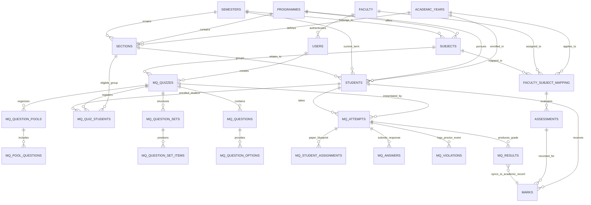

# MathQuiz – Database Discovery, Schema Inventory & Compatibility Report

**Document Version:** 1.1  
**Project:** MathQuiz & Academic Assessment Management System (AAMS)  
**Database:** Supabase PostgreSQL (`aws-1-us-east-2.pooler.supabase.com:5432/postgres`)  
**Status:** Audit Completed & Verified Live  

---

## 1. Executive Summary & Audit Verification

In strict accordance with **Section 4.1 (Database Discovery & Mapping)** and **Section 20 (Immediate Next Implementation Step)** of the MathQuiz Specification (v1.1), a live audit was performed directly against the production Supabase PostgreSQL database and the existing Vercel deployment repository.

### Key Audit Findings
1. **Existing Tables Preserved:** The database contains **15 core academic tables** with live institutional records (82 students, 5 faculty, 4 programmes, 6 sections, 8 semesters, 3 academic years, 56 assessments, 391 marks, 48 audit logs).
2. **Primary Key Typings:** All existing primary keys in the public schema (`students.id`, `faculty.id`, `users.id`, `subjects.id`, etc.) use **`INTEGER` (SERIAL)** sequences, **not `UUID`**.
3. **Student Identity:** 
   - SAP ID / Roll Numbers are stored in `students.register_number` (`VARCHAR(50)`) and mirrored in `students.student_id_code`.
   - Full student name is in `students.student_name` (`VARCHAR(120)`).
   - Email is in `students.email` (`VARCHAR(120)`).
4. **Authentication Architecture:** 
   - Supabase Auth (`auth.users`) currently has **0 records**.
   - Admin and faculty authentication is actively managed in `public.users` (`id INTEGER`, `username`, `password_hash` with scrypt, `role` [`admin`, `faculty`], `faculty_id INTEGER REFERENCES faculty(id)`).
5. **RLS & Security Status:** Row Level Security (RLS) is currently **disabled** across all existing academic tables (`rowsecurity = False`), and 0 policies exist. Introducing RLS for MathQuiz must be scoped strictly to new `mq_*` tables or additive policies to avoid breaking the existing academic system.

---

## 2. Live Database Inventory (15 Existing Public Tables)

| Table Name | Live Row Count | Primary Key | Description & Academic Purpose |
| :--- | :---: | :--- | :--- |
| `academic_years` | 3 | `id` (INTEGER) | Academic session tracking (`2024-25`, `2025-26`, `2026-27`) |
| `programmes` | 4 | `id` (INTEGER) | Academic programs (`CE`, `CSD`, `CSE`, `IT`) |
| `semesters` | 8 | `id` (INTEGER) | Semesters I through VIII |
| `sections` | 6 | `id` (INTEGER) | Section divisions (A, B) scoped to programme and semester |
| `subjects` | 8 | `id` (INTEGER) | Master course catalog (`MA201`, `CE202`, etc.) with credits and marks schema |
| `faculty` | 5 | `id` (INTEGER) | Faculty profiles, employee IDs (`FAC001`), departments, designations |
| `users` | 6 | `id` (INTEGER) | Portal login credentials, scrypt password hashes, role assignments |
| `faculty_subject_mapping` | 10 | `id` (INTEGER) | Junction tying faculty to specific subject, section, semester, and academic year |
| `students` | 82 | `id` (INTEGER) | Student master registry containing SAP/Register No, name, email, section |
| `student_enrollments` | 82 | `enrollment_id` (INTEGER) | Student term-wise enrollments across year, programme, semester, and section |
| `assessments` | 56 | `id` (INTEGER) | Component assessment definitions (Test 1, Test 2, Assignment, Quiz 1, ICA) |
| `marks` | 391 | `id` (INTEGER) | Student mark entries, score, status (`Present`, `Absent`, `Exempted`), remarks |
| `marks_audit` | 279 | `audit_id` (INTEGER) | Revision history of mark modifications with user attribution and reason |
| `submissions` | 5 | `id` (INTEGER) | Formal faculty mark submissions with Dean/Admin review workflows |
| `audit_logs` | 48 | `id` (INTEGER) | System audit trails (user_id, action, entity, IP address, timestamp) |

---

## 3. Detailed Column Specification for Core Integration Tables

### 3.1 `students` Table (Target for Quiz Authentication & Registration)
* **`id`** (`integer`, `NOT NULL`, Default: `nextval('students_id_seq')`) — Primary Key.
* **`register_number`** (`character varying(50)`, `NOT NULL`, Unique, Indexed) — **The official SAP ID / Institutional Roll No** (e.g. `2026CE001`, `70572600111`).
* **`student_id_code`** (`character varying(50)`, `NULL`) — Internal registration code.
* **`student_name`** (`character varying(120)`, `NOT NULL`) — Canonical registered student name.
* **`email`** (`character varying(120)`, `NULL`) — Official registered email address.
* **`programme_id`** (`integer`, `NOT NULL`) — FK to `programmes(id)`.
* **`academic_year_id`** (`integer`, `NOT NULL`) — FK to `academic_years(id)`.
* **`current_semester_id`** (`integer`, `NOT NULL`) — FK to `semesters(id)`.
* **`section_id`** (`integer`, `NOT NULL`) — FK to `sections(id)`.
* **`status`** (`character varying(20)`, `NOT NULL`, Default: `'Active'`).

### 3.2 `faculty` & `users` Tables (Target for Admin & Faculty Quiz Ownership)
* **`users.id`** (`integer`, `NOT NULL`, Default: `nextval('users_id_seq')`) — User account PK.
* **`users.username`** (`character varying(60)`, `NOT NULL`, Unique) — Login ID (`admin`, `faculty_a`, etc.).
* **`users.role`** (`character varying(20)`, `NOT NULL`) — `'admin'` or `'faculty'`.
* **`users.faculty_id`** (`integer`, `NULL`) — FK to `faculty(id)` (NULL for admin).
* **`faculty.faculty_id_code`** (`character varying(50)`, `NOT NULL`, Unique) — e.g. `FAC001`.
* **`faculty.name`** (`character varying(100)`, `NOT NULL`) — Faculty full name.
* **`faculty.email`** (`character varying(120)`, `NOT NULL`, Unique) — Institutional email.

### 3.3 `subjects` & `faculty_subject_mapping`
* **`subjects.id`** (`integer`, `NOT NULL`) — Subject PK.
* **`subjects.subject_code`** (`character varying`, `NOT NULL`) — e.g. `MA201`, `CE202`.
* **`subjects.subject_name`** (`character varying`, `NOT NULL`) — e.g. `Applied Mathematics II`.
* **`faculty_subject_mapping.id`** (`integer`, `NOT NULL`) — Mapping PK. Connects `faculty_id`, `subject_id`, `section_id`, `semester_id`, and `academic_year_id`.

---

## 4. Entity Relationship Diagram (Existing AAMS + New MathQuiz Module)



---

## 5. Schema Compatibility & Mapping Matrix

The following table demonstrates how the draft starter specifications are adapted to match the live Supabase PostgreSQL schema:

| Starter Assumption (v1.1 Draft) | Live Database Reality | Correct Additive Implementation |
| :--- | :--- | :--- |
| `student_id uuid` | `students.id` is `INTEGER` (SERIAL) | `student_id integer NOT NULL REFERENCES public.students(id)` |
| `sap_id text` | `students.register_number` is `VARCHAR(50)` | `sap_id varchar(50) NOT NULL` (indexed, matches `register_number`) |
| `created_by uuid` | `users.id` is `INTEGER`, `auth.users` is empty | `created_by integer NOT NULL REFERENCES public.users(id)` |
| `subject_id uuid` | `subjects.id` is `INTEGER` | `subject_id integer REFERENCES public.subjects(id)` |
| `auth.users` handles all login | `public.users` handles Admin/Faculty login | Preserve `public.users` auth; optionally support Supabase Auth tokens alongside |
| RLS assumed active | No RLS policies exist on public schema | Enable RLS **strictly** on new `mq_*` tables; leave existing 15 tables operational |
| Marks saved to isolated quiz table | Existing `marks` table tracks term-end ICA | `mq_results` records quiz scores, and on Admin "Publish", can sync into `public.marks` |

---

## 6. Recommended Additive SQL Migration (Implementation-Ready)

This migration script strictly creates the missing `mq_*` objects without touching existing records or breaking existing application functionality.

```sql
-- ============================================================================
-- MathQuiz Module - Additive Database Migration Script
-- Compatible with existing AAMS PostgreSQL Database on Supabase
-- ============================================================================

-- 1. Ensure required extensions
CREATE EXTENSION IF NOT EXISTS pgcrypto;

-- 2. Quizzes Master Configuration
CREATE TABLE IF NOT EXISTS public.mq_quizzes (
    id UUID PRIMARY KEY DEFAULT gen_random_uuid(),
    title TEXT NOT NULL,
    quiz_code VARCHAR(30) NOT NULL,
    subject_id INTEGER REFERENCES public.subjects(id) ON DELETE SET NULL,
    mapping_id INTEGER REFERENCES public.faculty_subject_mapping(id) ON DELETE SET NULL,
    duration_minutes INTEGER NOT NULL CHECK (duration_minutes > 0),
    total_marks NUMERIC(10,2) NOT NULL DEFAULT 0,
    passing_marks NUMERIC(10,2) DEFAULT 0,
    distribution_type VARCHAR(30) NOT NULL CHECK (distribution_type IN ('random_pool', 'round_robin', 'all_questions')),
    round_robin_mode VARCHAR(30) CHECK (round_robin_mode IN ('question_sets', 'individual_questions')),
    negative_marking_enabled BOOLEAN DEFAULT FALSE,
    negative_marks NUMERIC(10,2) DEFAULT 0,
    shuffle_questions BOOLEAN DEFAULT TRUE,
    shuffle_options BOOLEAN DEFAULT TRUE,
    max_violations_allowed INTEGER DEFAULT 3,
    result_release_status VARCHAR(20) NOT NULL DEFAULT 'hidden' CHECK (result_release_status IN ('hidden', 'published')),
    status VARCHAR(20) NOT NULL DEFAULT 'draft' CHECK (status IN ('draft', 'scheduled', 'active', 'completed', 'archived')),
    created_by INTEGER NOT NULL REFERENCES public.users(id),
    starts_at TIMESTAMPTZ,
    ends_at TIMESTAMPTZ,
    created_at TIMESTAMPTZ DEFAULT NOW(),
    updated_at TIMESTAMPTZ DEFAULT NOW(),
    UNIQUE (quiz_code)
);

-- 3. Quiz Student Eligibility & Registration
CREATE TABLE IF NOT EXISTS public.mq_quiz_students (
    id UUID PRIMARY KEY DEFAULT gen_random_uuid(),
    quiz_id UUID NOT NULL REFERENCES public.mq_quizzes(id) ON DELETE CASCADE,
    student_id INTEGER NOT NULL REFERENCES public.students(id) ON DELETE RESTRICT,
    sap_id VARCHAR(50) NOT NULL,
    registered_at TIMESTAMPTZ DEFAULT NOW(),
    is_eligible BOOLEAN DEFAULT TRUE,
    UNIQUE (quiz_id, student_id),
    UNIQUE (quiz_id, sap_id)
);

-- 4. Question Banks & Questions
CREATE TABLE IF NOT EXISTS public.mq_questions (
    id UUID PRIMARY KEY DEFAULT gen_random_uuid(),
    quiz_id UUID REFERENCES public.mq_quizzes(id) ON DELETE CASCADE,
    batch_name VARCHAR(100) DEFAULT 'Batch 1',
    topic VARCHAR(150),
    difficulty VARCHAR(20) DEFAULT 'Medium' CHECK (difficulty IN ('Easy', 'Medium', 'Hard')),
    latex_source TEXT NOT NULL,
    marks NUMERIC(10,2) NOT NULL DEFAULT 1.0,
    negative_marks NUMERIC(10,2) DEFAULT 0.0,
    explanation TEXT,
    created_at TIMESTAMPTZ DEFAULT NOW()
);

-- 5. Question MCQ Options
CREATE TABLE IF NOT EXISTS public.mq_question_options (
    id UUID PRIMARY KEY DEFAULT gen_random_uuid(),
    question_id UUID NOT NULL REFERENCES public.mq_questions(id) ON DELETE CASCADE,
    option_key CHAR(1) NOT NULL CHECK (option_key IN ('A', 'B', 'C', 'D', 'E')),
    latex_source TEXT NOT NULL,
    is_correct BOOLEAN NOT NULL DEFAULT FALSE,
    display_order INTEGER NOT NULL DEFAULT 1,
    UNIQUE (question_id, option_key)
);

-- 6. Round-Robin Question Sets
CREATE TABLE IF NOT EXISTS public.mq_question_sets (
    id UUID PRIMARY KEY DEFAULT gen_random_uuid(),
    quiz_id UUID NOT NULL REFERENCES public.mq_quizzes(id) ON DELETE CASCADE,
    set_name VARCHAR(20) NOT NULL, -- 'Set A', 'Set B', etc.
    sequence INTEGER NOT NULL,
    created_at TIMESTAMPTZ DEFAULT NOW(),
    UNIQUE (quiz_id, set_name)
);

CREATE TABLE IF NOT EXISTS public.mq_question_set_items (
    id UUID PRIMARY KEY DEFAULT gen_random_uuid(),
    set_id UUID NOT NULL REFERENCES public.mq_question_sets(id) ON DELETE CASCADE,
    question_id UUID NOT NULL REFERENCES public.mq_questions(id) ON DELETE CASCADE,
    position INTEGER NOT NULL,
    UNIQUE (set_id, question_id),
    UNIQUE (set_id, position)
);

-- 7. Student Examination Attempts
CREATE TABLE IF NOT EXISTS public.mq_attempts (
    id UUID PRIMARY KEY DEFAULT gen_random_uuid(),
    quiz_id UUID NOT NULL REFERENCES public.mq_quizzes(id) ON DELETE RESTRICT,
    student_id INTEGER NOT NULL REFERENCES public.students(id) ON DELETE RESTRICT,
    sap_id VARCHAR(50) NOT NULL,
    session_token_hash VARCHAR(64) NOT NULL,
    assigned_set_id UUID REFERENCES public.mq_question_sets(id),
    started_at TIMESTAMPTZ NOT NULL DEFAULT NOW(),
    expires_at TIMESTAMPTZ NOT NULL,
    submitted_at TIMESTAMPTZ,
    status VARCHAR(30) NOT NULL DEFAULT 'in_progress' CHECK (status IN ('in_progress', 'submitted', 'auto_submitted', 'disqualified')),
    total_marks NUMERIC(10,2),
    submission_reason TEXT,
    client_ip VARCHAR(50),
    created_at TIMESTAMPTZ DEFAULT NOW(),
    UNIQUE (quiz_id, student_id)
);

-- 8. Generated Student Question Paper Assignments (Immutable Record)
CREATE TABLE IF NOT EXISTS public.mq_student_assignments (
    id UUID PRIMARY KEY DEFAULT gen_random_uuid(),
    attempt_id UUID NOT NULL REFERENCES public.mq_attempts(id) ON DELETE CASCADE,
    question_id UUID NOT NULL REFERENCES public.mq_questions(id) ON DELETE RESTRICT,
    position INTEGER NOT NULL,
    options_permutation JSONB, -- records shuffled option keys e.g. ['C', 'A', 'D', 'B']
    created_at TIMESTAMPTZ DEFAULT NOW(),
    UNIQUE (attempt_id, question_id),
    UNIQUE (attempt_id, position)
);

-- 9. Student Answers
CREATE TABLE IF NOT EXISTS public.mq_answers (
    id UUID PRIMARY KEY DEFAULT gen_random_uuid(),
    attempt_id UUID NOT NULL REFERENCES public.mq_attempts(id) ON DELETE CASCADE,
    question_id UUID NOT NULL REFERENCES public.mq_questions(id) ON DELETE RESTRICT,
    selected_option CHAR(1),
    answered_at TIMESTAMPTZ DEFAULT NOW(),
    idempotency_key VARCHAR(64),
    UNIQUE (attempt_id, question_id)
);

-- 10. Proctoring & Security Violations
CREATE TABLE IF NOT EXISTS public.mq_violations (
    id UUID PRIMARY KEY DEFAULT gen_random_uuid(),
    attempt_id UUID NOT NULL REFERENCES public.mq_attempts(id) ON DELETE CASCADE,
    violation_type VARCHAR(100) NOT NULL,
    event_time TIMESTAMPTZ DEFAULT NOW(),
    strike_number INTEGER NOT NULL,
    metadata JSONB DEFAULT '{}'::JSONB
);

-- 11. Final Results & Question-wise Marks
CREATE TABLE IF NOT EXISTS public.mq_question_marks (
    id UUID PRIMARY KEY DEFAULT gen_random_uuid(),
    attempt_id UUID NOT NULL REFERENCES public.mq_attempts(id) ON DELETE CASCADE,
    question_id UUID NOT NULL REFERENCES public.mq_questions(id) ON DELETE RESTRICT,
    is_correct BOOLEAN NOT NULL,
    awarded_marks NUMERIC(10,2) NOT NULL,
    evaluated_at TIMESTAMPTZ DEFAULT NOW(),
    UNIQUE (attempt_id, question_id)
);

CREATE TABLE IF NOT EXISTS public.mq_results (
    id UUID PRIMARY KEY DEFAULT gen_random_uuid(),
    attempt_id UUID NOT NULL REFERENCES public.mq_attempts(id) ON DELETE CASCADE,
    quiz_id UUID NOT NULL REFERENCES public.mq_quizzes(id) ON DELETE CASCADE,
    student_id INTEGER NOT NULL REFERENCES public.students(id) ON DELETE RESTRICT,
    sap_id VARCHAR(50) NOT NULL,
    attendance_status VARCHAR(20) NOT NULL DEFAULT 'Present',
    raw_score NUMERIC(10,2) NOT NULL DEFAULT 0,
    grace_marks NUMERIC(10,2) DEFAULT 0,
    adjustment_marks NUMERIC(10,2) DEFAULT 0,
    final_score NUMERIC(10,2) NOT NULL DEFAULT 0,
    percentage NUMERIC(5,2) NOT NULL DEFAULT 0,
    evaluated_at TIMESTAMPTZ DEFAULT NOW(),
    is_published BOOLEAN DEFAULT FALSE,
    published_at TIMESTAMPTZ,
    UNIQUE (attempt_id),
    UNIQUE (quiz_id, student_id)
);

-- 12. Indexes for 500-Candidate Concurrency
CREATE INDEX IF NOT EXISTS idx_mq_quizzes_code ON public.mq_quizzes(quiz_code);
CREATE INDEX IF NOT EXISTS idx_mq_attempts_quiz_status ON public.mq_attempts(quiz_id, status);
CREATE INDEX IF NOT EXISTS idx_mq_attempts_token_hash ON public.mq_attempts(session_token_hash);
CREATE INDEX IF NOT EXISTS idx_mq_answers_attempt ON public.mq_answers(attempt_id);
CREATE INDEX IF NOT EXISTS idx_mq_student_assignments_attempt ON public.mq_student_assignments(attempt_id);
CREATE INDEX IF NOT EXISTS idx_mq_violations_attempt ON public.mq_violations(attempt_id, event_time);
CREATE INDEX IF NOT EXISTS idx_mq_results_quiz_sap ON public.mq_results(quiz_id, sap_id);
```
