# MathQuiz – Entity-Relationship Diagram (ERD)
**Document Code:** MQ-ERD-001  
**Project:** MathQuiz Mathematics Examination & Assessment Management System  
**Version:** 1.0  
**Date:** 15 November 2026  

---

## 1. Overview
This diagram represents the integrated database architecture combining the existing Academic Assessment Management System (AAMS) with the additive MathQuiz (`mq_*`) online examination module on Supabase PostgreSQL.

---

## 2. Mermaid Entity-Relationship Diagram

```mermaid
erDiagram
    %% ==========================================
    %% EXISTING CORE ACADEMIC TABLES
    %% ==========================================
    STUDENTS {
        int id PK
        string register_number UK "SAP ID / Roll No (Text)"
        string student_name
        string email
        string roll_number
        int section_id FK
        string status
    }

    USERS {
        int id PK
        string username UK
        string password_hash
        string role "Admin or Faculty"
        string faculty_id FK
        string status
    }

    SUBJECTS {
        int id PK
        string subject_code UK
        string subject_name
        int semester_id FK
        string status
    }

    FACULTY_SUBJECT_MAPPING {
        int id PK
        int faculty_id FK
        int subject_id FK
        int section_id FK
        int academic_year_id FK
    }

    %% ==========================================
    %% MATHQUIZ EXAMINATION MODULE (mq_*)
    %% ==========================================
    MQ_QUIZZES {
        uuid id PK
        string title
        string quiz_code UK "Unique Passcode"
        int subject_id FK "References public.subjects(id)"
        int duration_minutes "Server Authoritative Expiry"
        int total_questions
        numeric total_marks
        string distribution_type "random_pool, round_robin, all_questions"
        string round_robin_mode "question_sets or individual_questions"
        boolean negative_marking_enabled
        numeric negative_marks
        int max_violations_allowed "Proctoring strikes default 3"
        string result_release_status "hidden or published"
        string status "draft, active, completed"
        int created_by FK "References public.users(id)"
    }

    MQ_QUIZ_STUDENTS {
        uuid id PK
        uuid quiz_id FK
        int student_id FK "References public.students(id)"
        string sap_id "Preserves leading zeros"
        boolean is_eligible
    }

    MQ_QUESTION_BANKS {
        uuid id PK
        string name
        int subject_id FK
        int created_by FK
    }

    MQ_QUESTIONS {
        uuid id PK
        uuid quiz_id FK
        uuid question_bank_id FK
        string question_type "single or multiple"
        text latex_source "LaTeX question math syntax"
        string topic
        string difficulty "Easy, Medium, Hard"
        numeric marks
        numeric negative_marks
        text explanation
        boolean is_active
    }

    MQ_QUESTION_OPTIONS {
        uuid id PK
        uuid question_id FK
        char option_key "A, B, C, D"
        text latex_source "LaTeX option math syntax"
        boolean is_correct "Hidden from students"
        int display_order
    }

    MQ_QUESTION_POOLS {
        uuid id PK
        uuid quiz_id FK
        string pool_name
        int required_count
        numeric marks_per_question
    }

    MQ_POOL_QUESTIONS {
        uuid id PK
        uuid pool_id FK
        uuid question_id FK
    }

    MQ_QUESTION_SETS {
        uuid id PK
        uuid quiz_id FK
        string set_name "Set A, Set B, etc."
        int sequence
    }

    MQ_QUESTION_SET_ITEMS {
        uuid id PK
        uuid set_id FK
        uuid question_id FK
        int position
    }

    MQ_ATTEMPTS {
        uuid id PK
        uuid quiz_id FK
        int student_id FK "References public.students(id)"
        string sap_id
        string session_token_hash "SHA-256 of session token"
        int attempt_number "Default 1, increments on Admin Retake"
        timestamptz started_at
        timestamptz expires_at "Server Expiry"
        timestamptz submitted_at
        string status "in_progress, submitted, auto_submitted, disqualified"
        numeric total_marks
    }

    MQ_STUDENT_ASSIGNMENTS {
        uuid id PK
        uuid attempt_id FK
        uuid question_id FK
        int position "Permanent paper sequence"
        jsonb options_permutation "Option shuffle snapshot"
    }

    MQ_ANSWERS {
        uuid id PK
        uuid attempt_id FK
        uuid question_id FK
        char selected_option "Single-answer key"
        jsonb selected_options "Multiple-answer array"
        string idempotency_key
        int revision_number
        timestamptz answered_at
    }

    MQ_QUESTION_MARKS {
        uuid id PK
        uuid attempt_id FK
        uuid question_id FK
        numeric maximum_marks
        numeric awarded_marks "Exact match scoring"
        boolean is_correct
    }

    MQ_RESULTS {
        uuid id PK
        uuid attempt_id FK
        uuid quiz_id FK
        int student_id FK
        string sap_id
        string attendance_status "Present, Absent"
        numeric final_score
        numeric maximum_marks
        numeric percentage
        string result_status "EVALUATED, FINALIZED, PUBLISHED"
        boolean is_published "Admin Release Gate"
    }

    MQ_ATTENDANCE {
        uuid id PK
        uuid quiz_id FK
        int student_id FK
        string sap_id
        string attendance_status "Present, Absent, In-Progress"
        timestamptz marked_at
    }

    MQ_VIOLATIONS {
        uuid id PK
        uuid attempt_id FK
        string violation_type "Fullscreen exit, blur, printscreen, tab switch"
        int strike_number
        jsonb metadata
        timestamptz event_time
    }

    MQ_ACTIVITY_LOGS {
        uuid id PK
        int actor_user_id FK
        string action "AUTHORIZE_RETAKE, PUBLISH_RESULTS"
        string entity_type
        jsonb details
        timestamptz created_at
    }

    %% ==========================================
    %% RELATIONSHIPS
    %% ==========================================
    SUBJECTS ||--o{ MQ_QUIZZES : "categorizes"
    USERS ||--o{ MQ_QUIZZES : "creates"
    STUDENTS ||--o{ MQ_QUIZ_STUDENTS : "rostered in"
    MQ_QUIZZES ||--o{ MQ_QUIZ_STUDENTS : "enrolls"
    MQ_QUIZZES ||--o{ MQ_QUESTIONS : "contains"
    MQ_QUESTION_BANKS ||--o{ MQ_QUESTIONS : "groups"
    MQ_QUESTIONS ||--|{ MQ_QUESTION_OPTIONS : "has 4 choices"
    MQ_QUIZZES ||--o{ MQ_QUESTION_POOLS : "configures"
    MQ_QUESTION_POOLS ||--o{ MQ_POOL_QUESTIONS : "maps"
    MQ_QUESTIONS ||--o{ MQ_POOL_QUESTIONS : "included in"
    MQ_QUIZZES ||--o{ MQ_QUESTION_SETS : "configures"
    MQ_QUESTION_SETS ||--o{ MQ_QUESTION_SET_ITEMS : "sequences"
    MQ_QUESTIONS ||--o{ MQ_QUESTION_SET_ITEMS : "allocated to"
    MQ_QUIZZES ||--o{ MQ_ATTEMPTS : "records"
    STUDENTS ||--o{ MQ_ATTEMPTS : "takes"
    MQ_ATTEMPTS ||--|{ MQ_STUDENT_ASSIGNMENTS : "permanently assigns"
    MQ_ATTEMPTS ||--o{ MQ_ANSWERS : "submits"
    MQ_ATTEMPTS ||--o{ MQ_VIOLATIONS : "incurs strikes in"
    MQ_ATTEMPTS ||--o{ MQ_QUESTION_MARKS : "evaluated in"
    MQ_ATTEMPTS ||--|| MQ_RESULTS : "scores"
    MQ_QUIZZES ||--o{ MQ_RESULTS : "publishes"
    MQ_QUIZZES ||--o{ MQ_ATTENDANCE : "tracks"
    STUDENTS ||--o{ MQ_ATTENDANCE : "marked in"
```

